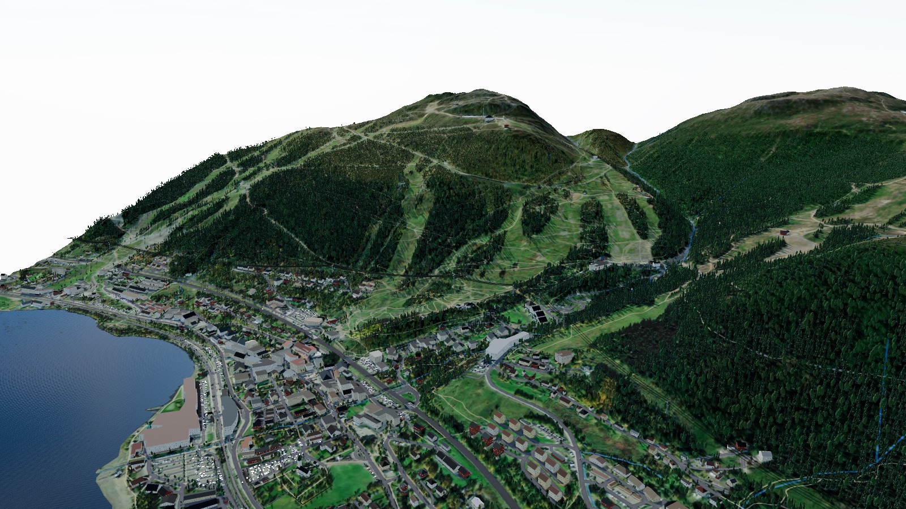
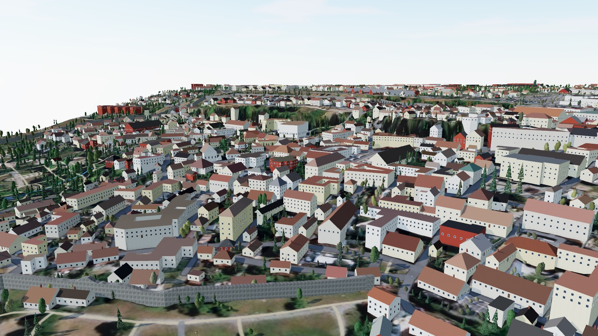
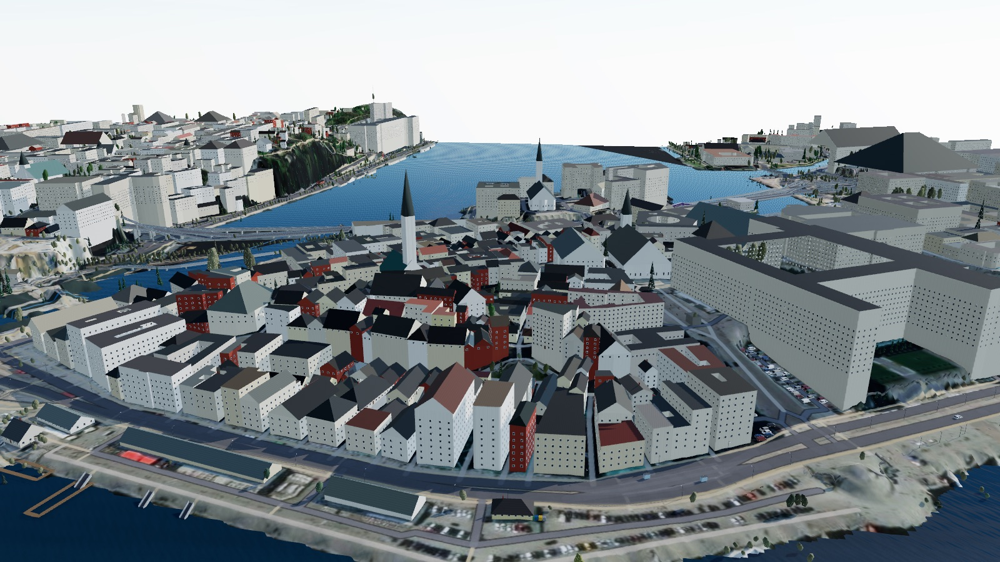
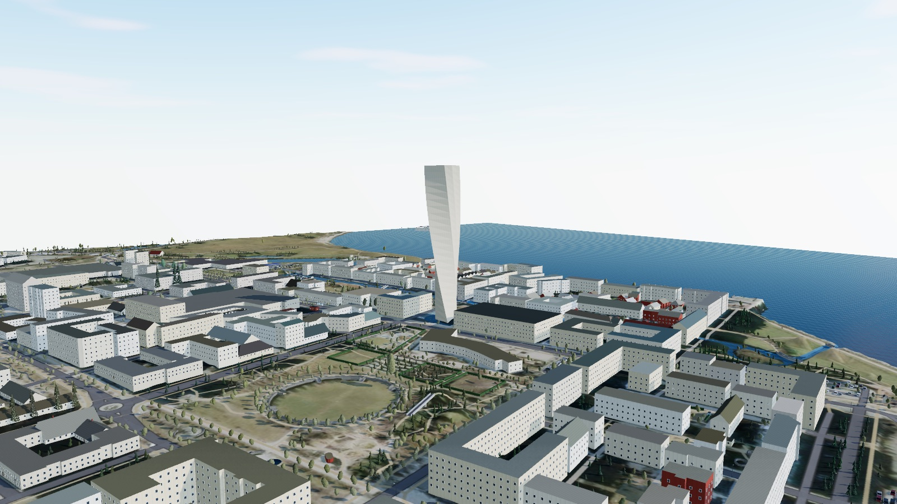
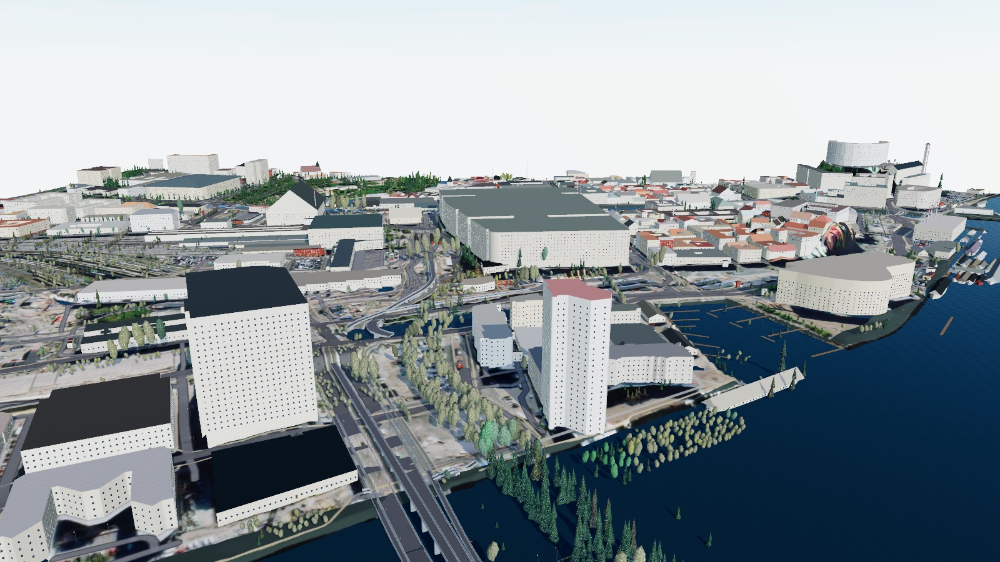
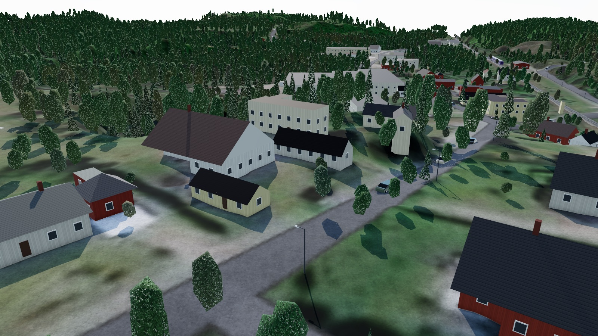
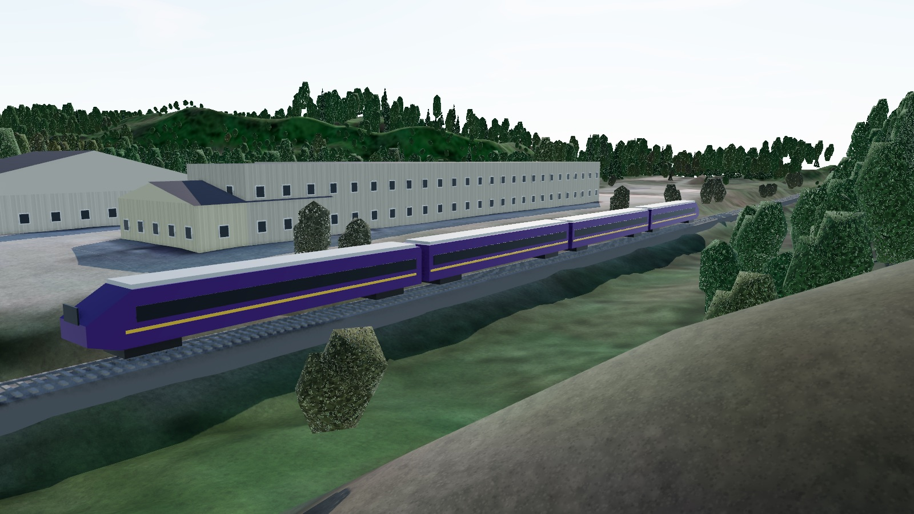
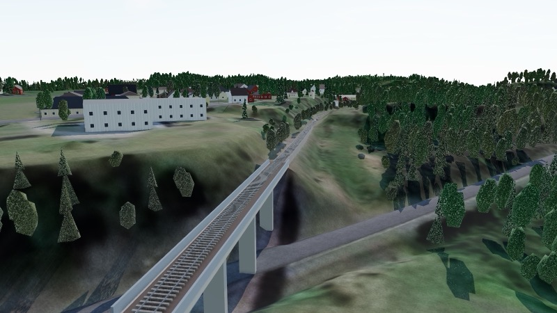
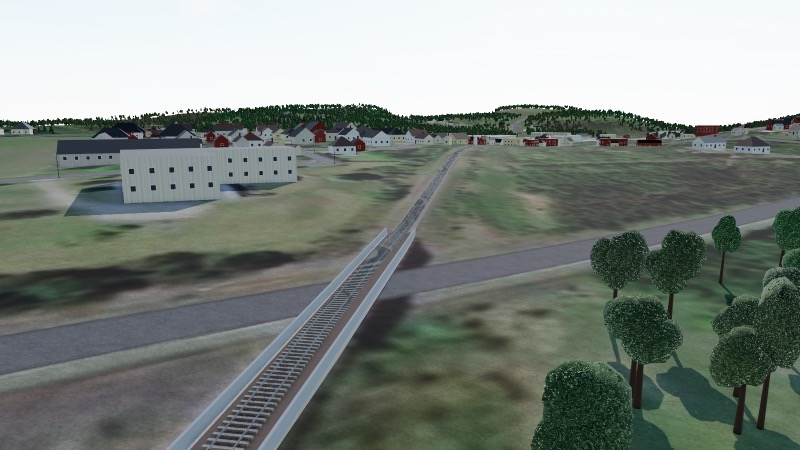

<div align="center">

# Hometown

### Any place on Earth as a living 3D diorama, built live from open data.

Type a place, and seconds later you're flying over it: real terrain, every building with its roof,
aerial photos, forests tree by tree, cars on the roads and trains on the tracks.
In Sweden it goes further: **1 m laser terrain, real measured trees and real roof shapes** from Lantmäteriet.



<sub>Åre, Jämtland: 1 m terrain, 60,000 laser-measured trees, the ski slopes straight from the aerial photo.</sub>

</div>

---

## Sweden, rebuilt from open data

<table>
  <tr>
    <td width="50%"><br><sub><b>Visby</b>: the medieval ringmur and the old town climbing the hill, with 874 roofs measured from laser data.</sub></td>
    <td width="50%"><br><sub><b>Stockholm, Gamla stan</b>: church spires, the Royal Palace and the water all around.</sub></td>
  </tr>
  <tr>
    <td><br><sub><b>Malmö</b>: the Turning Torso (twist included) over Västra Hamnen and the Öresund.</sub></td>
    <td><br><sub><b>Gothenburg</b>: Lilla Bommen, Göta älv and the city centre.</sub></td>
  </tr>
  <tr>
    <td><br><sub><b>Mala, Skåne</b>: falu-red houses, real garden trees, windows, chimneys and street lamps.</sub></td>
    <td><br><sub><b>Trains and traffic</b>: click any car or train to follow it with a chase camera.</sub></td>
  </tr>
</table>

## What makes it special

- **Any place, instantly.** Search a name or `lat, lon` and pick 1–3 km. Everything is generated on the fly; nothing is pre-modelled.
- **Real terrain.** Global elevation everywhere, and Lantmäteriet's **1 m terrain model** in Sweden: every ditch, embankment and ski slope.
- **Real trees.** In Sweden every tree comes from **airborne laser scanning**, with its true position, height and crown. Elsewhere, forests are filled from the map.
- **Real roofs.** Roof height, pitch, ridge direction and shape (flat, gabled or hipped) are **measured from laser points** for each building.
- **It's alive.** Cars drive the actual road network on the right-hand side; Pågatåg and freight trains run the actual railways, over 3D track and bridges.
- **Looks the part.** Physical sky, soft shadows, ambient occlusion, rippling lakes and sea, leafy trees, houses with windows, doors and chimneys, and parked cars, street lamps, bus stops, fences and stone walls.
- **Fun to explore.** Hover for street and building names, follow any vehicle, drive the camera like a city builder (grab-drag, WASD, Q/E), save screenshots, and pick a map style (illustrated, hybrid or satellite).

## Sweden in HD

Hometown works anywhere with open data. In Sweden it can also use Lantmäteriet's laser data, and it makes a big difference.
Flip the **Data** switch in the app to compare:

<table>
  <tr>
    <td width="50%"><br><sub><b>Lantmäteriet HD</b>: the railway runs on its embankment and crosses the cutting on a bridge, with the trees that really grow there.</sub></td>
    <td width="50%"><br><sub><b>Open data only</b>: 30 m terrain smooths the cutting away, and trees are estimated.</sub></td>
  </tr>
</table>

## Get started

Hometown is one small Rust binary (with the web app embedded) plus Postgres. The quickest way to run it is Docker:

```bash
docker compose up --build
```

Open http://localhost:3000. That's it: everything works with open data out of the box.

### Develop

Requirements: Rust, Bun, [just](https://github.com/casey/just) and Docker (for Postgres).

```bash
just dev      # Postgres + api on :3000 + Vite on :5173, in the background
just check    # migrate, regenerate types, compile, typecheck, reload the api
just verify   # + format, clippy, tests and the frontend build
```

Then open http://localhost:5173. Built on [northstack](https://github.com/elitan/northstack); see [CLAUDE.md](CLAUDE.md) for how the code is organised.

### Turn on Sweden HD (optional, free)

1. Create a free account on [Geotorget](https://geotorget.lantmateriet.se/) and order the free products
   **Markhöjdmodell Nedladdning** and **Laserdata Nedladdning, skog**.
2. Add your login to `.env` (created from `.env.example` by `just dev`; Docker Compose reads it too):

   ```
   LM_USER=you@example.com
   LM_PASS=your-password
   ```

The login is only used by the server and never reaches the browser. Each area is processed once
(a few seconds to half a minute the first time) and then served from Postgres.

### Controls

| | |
| --- | --- |
| Left-drag (grab the ground) / WASD / arrow keys | Move |
| Right- or middle-drag / Q E / Shift + ← → | Rotate |
| Right- or middle-drag / R F / Shift + ↑ ↓ | Tilt |
| Scroll / + − / Page Up, Page Down | Zoom |
| Click a car or train | Follow it (Esc to stop) |

## How it works

```
place name ─► Nominatim ─► OpenStreetMap ─► buildings, roads, water, land use, street furniture
                        ├► elevation ─────► Lantmäteriet 1 m (Sweden) or global Terrain Tiles
                        ├► aerial photo ──► Esri World Imagery (texture + roof colours)
                        └► laser points ──► server: canopy height ─► tree tops + roof shapes
                                                       │
                            three.js scene ◄───────────┘  sky, shadows, AO, water, traffic, trains
```

| Part | Where |
| --- | --- |
| Data sources | `web/src/lib/map/sources.ts` |
| Scene, terrain, buildings, labels, camera | `web/src/lib/map/engine.ts` |
| Lighting and post-processing | `web/src/lib/map/look.ts` |
| Trees · houses · roofs · water | `forest.ts` · `houses.ts` · `roofs.ts` · `water.ts` |
| Bridges · railway and trains · road traffic | `bridges.ts` · `rail.ts` · `traffic.ts` |
| Street furniture | `props.ts` |
| Laser processing (server, Rust) | `app/src/features/lm/laser.rs` |
| 1 m terrain (server, Rust) | `app/src/features/lm/dtm.rs` |

The server is Rust ([northstack](https://github.com/elitan/northstack): axum, sqlx, Postgres) and reads
Lantmäteriet's Cloud Optimized GeoTIFFs and COPC point clouds directly, downloading only the parts under
the area. The browser side is React and three.js, built with Vite.

## Data and credits

- Map data © [OpenStreetMap](https://www.openstreetmap.org/copyright) contributors (ODbL); place search by [Nominatim](https://nominatim.org/).
- Global elevation: [Terrain Tiles](https://registry.opendata.aws/terrain-tiles/) (Mapzen / AWS Open Data).
- Aerial imagery: Esri World Imagery, © Esri, Maxar, Earthstar Geographics. Check
  [Esri's terms](https://www.esri.com/en-us/legal/terms/full-master-agreement) before any commercial use.
- Sweden: terrain model and forest laser data © [Lantmäteriet](https://www.lantmateriet.se/), open data under their terms.

These services are free and shared, so please keep requests reasonable (the app caches what it can).
